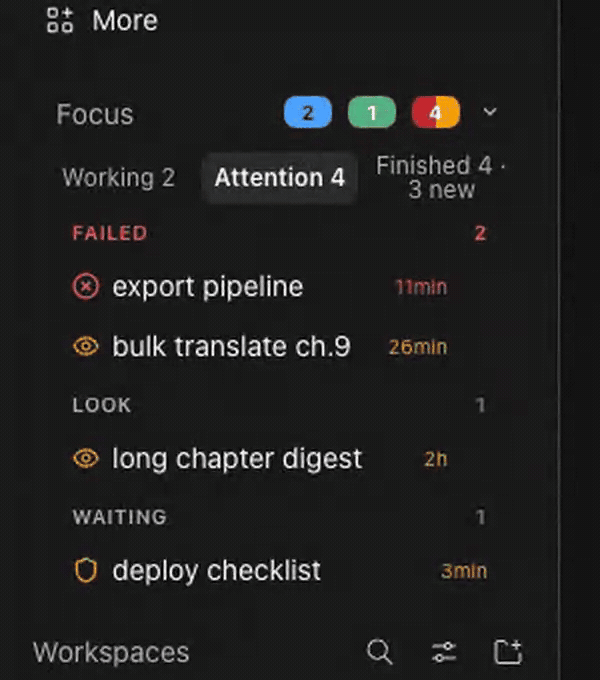
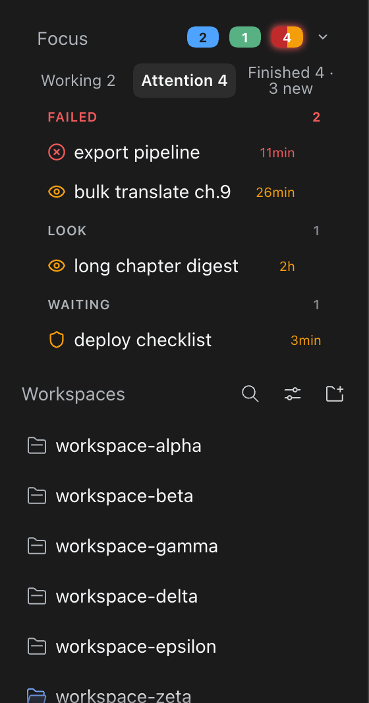
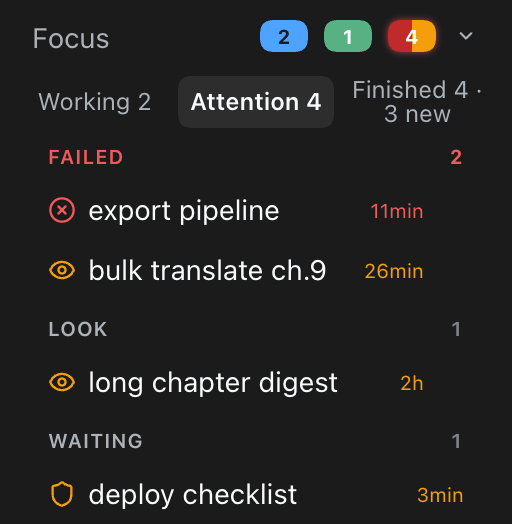
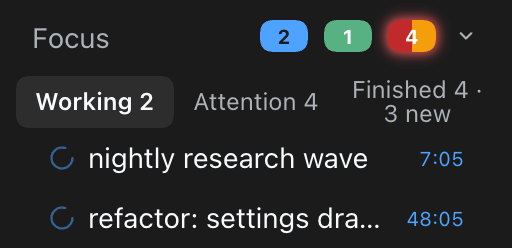
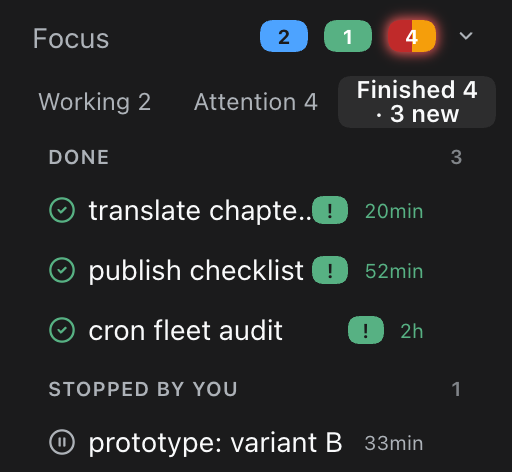
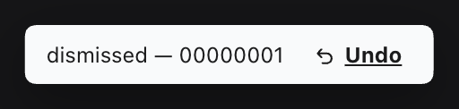
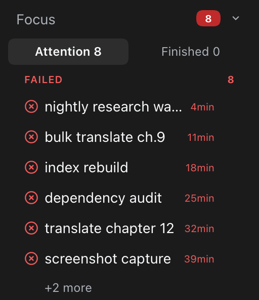

# @almazom/dsh-needs-attention-sidebar

English | [简体中文](README.zh-CN.md)

**A "Needs attention" block for the [DeepSeek Harness (DSH)](https://github.com/volcengine/dsh) web sidebar — live triage of your agent sessions: what is working, what died, what needs your decision.**

  

When you run many agent sessions, failures are quiet: a turn dies with a 429 or a fatal API error, and the session just sits there looking "open". This plugin gives those sessions a face. It injects a compact **Focus** block above the *Workspaces* section of the DSH web sidebar, with three tabs:

- **Working** — sessions with an open turn right now, with ticking durations.
- **Attention** — sessions that stopped badly and need a human look: fatal errors (red), rate-limit/quota pressure (amber), blocked sessions awaiting approval (amber shield), and "look" states like a truncated `max-tokens` reply or a hook abort.
- **Finished** — sessions that completed (green), including ones you stopped yourself, with unseen `!` badges and a `· N new` counter.

Zero core edits: everything is a plugin — a server-side scan route plus a small client script that anchors into the existing sidebar DOM.



| In place | Attention | Working | Finished |
|---|---|---|---|
|  |  |  |  |

| Dismiss with undo | Long list, `+2 more` cap | Collapsed |
|---|---|---|
|  |  |  |

## The idea

Agent harnesses are great at *starting* work and terrible at *mourning* it. A session whose last event is `error: 429 Too Many Requests` looks identical in the sidebar to one that is halfway through a two-hour refactor. You find out when you open it — or two days later.

The mental model is a hospital triage board, not a log viewer:

```
┌────────────────────────────────────────────────────┐
│  Focus                        [2]  [1]  [4]      ⌄ │
│  Working 2    Attention 4    Finished 4 · 3 new    │
├────────────────────────────────────────────────────┤
│  FAILED                                        2   │
│    ⊗  export pipeline                     11min    │   red   = fatal turn error
│    ◉  bulk translate ch.9                 26min    │   amber = 429 / quota / billing
│  LOOK                                          1   │
│    ◉  long chapter digest                   2h     │   amber = suspicious state,
│  WAITING                                        1  │           needs a human look
│    ⛨  deploy checklist                    3min     │   amber = approval unanswered
└────────────────────────────────────────────────────┘
```

Three design rules:

1. **The scan never costs a request you didn't make.** The client polls the plugin's own route; the route scans session logs *on request* (no background daemon, no watcher), caches by file mtime, throttles responses to one scan per 20s, and gives up after 10s with `504 scan-timeout`. An idle sidebar costs nothing.
2. **Titles never leak secrets.** Every row title passes a redaction pass (`sk-…` keys, `Bearer …` tokens, `token=…` query shapes are stripped) before it leaves the server.
3. **The harness stays untouched.** The block is a client-side DOM injection above the existing *Workspaces* section; the only server surface is one read-only, admission-guarded plugin route. Uninstall = the sidebar looks exactly as before.

## Install

## Upgrading

Install over the same URL (Plugins → Add plugin → paste the GitHub address, or `dsh plugin --profile web add https://github.com/almazom/dsh-needs-attention-sidebar`). The plugin remounts in place; your saved state (dismissals, collapsed head, last visit) is kept.


Requires DSH `>=0.2.0-rc.1` (checked at install time via `engines.dsh`).

Install straight from GitHub — no npm needed. In the DSH web UI open **Plugins → Add plugin** and paste the repository address, or run:

```bash
dsh plugin --profile web add github:almazom/dsh-needs-attention-sidebar
```

That's it. The command installs the package into the profile, and because the package declares `dsh.bundle.patch`, DSH auto-registers the plugin's cordis patch. Restart the web lane (or reload the page) and the **Focus** block appears above *Workspaces*.

Once the package is also published to npm, the package name works as an alternative:

```bash
dsh plugin --profile web add @almazom/dsh-needs-attention-sidebar
```

No build step, no lifecycle scripts, plain JavaScript — nothing runs on install.

## Reading the block

### Header chips

`[2] blue` sessions working · `[1] green` finished since your last visit · `[4] amber` need attention. The chevron collapses the block to just the header row (persisted).

### Tabs

- **Working N** — live sessions. Each row ticks its open-turn duration once per second.
- **Attention N** — warnings only, grouped:
  - **FAILED** (red ⊗) — the session's last terminal event is a fatal turn error/abort (5xx, auth, model failure, 413 payload).
  - **LOOK** (amber ◉) — states that usually mean degraded output or a stall: `blocked`, `max-tokens` truncation, hook abort, or rate-limit pressure (429 / quota / billing / 5-hour cap patterns → this amber "limit" class, not red).
  - **WAITING** (amber ⛨) — a tool/approval request has been sitting unanswered.
- **Finished N · M new** — completed (green ✓) and stopped-by-you (muted ⏸) sessions. Rows you have not opened since they finished carry a green `!` badge ("new", not "alarm" — attention is the red/amber groups' job); a divider marks everything "since your last visit".

### Row affordances

- `×` dismisses a row (kept across reloads, with an **Undo** toast).
- Every tab, group and row has keyboard focus and ARIA labels; the same actions work without a mouse.
- If more rows exist than fit, the group scrolls with a `+N more` cap (20 rows max per list — the scanner refuses to blow up your sidebar on a bad day).

### What the scanner considers "recent"

Only sessions touched within the freshness window are scanned (default **12 hours**, configurable). Older sessions are not your problem anymore; that's the whole point of the block.

## Privacy & safety

- **Local only.** The scan reads session logs on your machine and serves them to your browser session. The route answers only the authenticated DSH web connection (exact-route admission guard; loopback fallback), rejects non-`GET` with `405`, and never caches (`Cache-Control: no-store`).
- **No telemetry, no external calls.** The plugin makes zero network requests anywhere.
- **Redaction at the server.** Titles are redacted before serialization — key prefixes, bearer headers and token query parameters never reach the DOM.
- **Read-only.** The scanner only reads the harness session-log directory (`$DSH_HOME/sessions`, default `~/.dsh/sessions`). It writes nothing.

## Requirements

- DSH `>=0.2.0-rc.1`
- `zstd` on the web lane's `PATH` (`zstdcat` is used to stream session logs; on macOS: `brew install zstd`)

## Configuration

Environment variables (set them for the DSH web lane process, e.g. in its launchd plist or start script):

| Variable | Default | Meaning |
|---|---|---|
| `DSH_NEEDS_ATTN_WINDOW_H` | `12` | Freshness window in hours (1–720). Only sessions modified within the window are scanned. |
| `DSH_NEEDS_ATTN_DEADLINE_MS` | `10000` | Scan deadline. Past it the route answers `504 {"error":"scan-timeout"}` instead of blocking. |

## Under the hood

```
browser (client.js)                    dsh web lane (index.mjs → host.mjs → scanner.mjs)
──────────────────                     ──────────────────────────────────────────────
anchor: sidebar section label   poll   GET /api/dsh-needs-attention/sessions
  [class*="_sectionLabel"]  ──────────▶  admission guard (authenticated connection
inject <section> above                 or loopback) → 403 otherwise
  Workspaces                    ◀──────  on request: list recent session files
tabs / groups / ticks / unseen            (mtime cache, 20s throttle, single-flight)
dismiss + undo toast (localStorage)     zstdcat each file, tail-ring of 50 events
collapse / +N more / aria               → classify last terminal event + liveness
window.__DNA_STATUS__ diagnostics       → redact titles → rows (≤20), groups, counts
```

- **Server** (`src/scanner.mjs`, `src/host.mjs`): one GET route. Streams only the tail of each session log (50-event ring), 6 files in parallel, per-file 8s timeout, event-loop yields so a scan never stalls the lane, 8MB/60s reuse cache for big logs. Classifies each session into `working / waiting / look / fatal / limit / ok / stopped` using the last terminal event plus liveness (open turn + recent file mtime).
- **Client** (`src/client.js`): a ModuleLoader factory that injects once, anchors on the existing section label (works across locales — `Workspaces`/`工作区`/`Sessions`/`会话`), polls 10s when there are rows / 30s when empty, and degrades gracefully against an older server (errors-only strip).
- **Wiring** (`index.mjs`, `cordis.patch.yml`): the plugin injects `webServer` + `connection` and registers its cordis insert. DSH discovers all of this from `package.json` — the core never learns this plugin exists.

## Compatibility

| DSH | Status |
|---|---|
| `>=0.2.0-rc.1` | supported (enforced via top-level `engines.dsh`) |

The client carries a strip-states guard: paired with an older server build it falls back to an errors-only list instead of breaking.

## Development

```bash
npm install        # dev only: nothing to build, plain JS
npm test           # 44 tests (node:test) — scanner, host route, client, wiring
```

```
index.mjs            host entry (name / inject / apply)
src/host.mjs         route + admission guard + deadlines
src/scanner.mjs      session scan, classification, redaction
src/client.js        sidebar injection + UI (vanilla JS, no deps)
cordis.patch.yml     cordis insert declaration
tests/               node:test suite
screenshots/         the images used by this README
```

Runtime dependencies: **none** (npm). The client is dependency-free vanilla JS; the server uses only Node built-ins plus the system `zstd` binary (see Requirements).

## License

[MIT](LICENSE)
