# @almazom/dsh-needs-attention-sidebar

[English](README.md) | 简体中文

**[DeepSeek Harness（DSH）](https://github.com/volcengine/dsh) Web 侧边栏的「需要关注」区块 —— 实时分诊你的智能体会话：哪些在跑、哪些挂了、哪些等你拍板。**

  

当你同时运行许多智能体会话时，失败是无声的：某个回合以 429 或致命 API 错误收场，会话却依然「挂在那里」装作还开着。这个插件给这些会话一张脸。它在 DSH Web 侧边栏 *Workspaces（工作区）* 区块上方注入一个紧凑的 **Focus** 区块，包含三个标签页：

- **Working（进行中）** —— 当前有开放回合的会话，实时跳动计时。
- **Attention（需关注）** —— 停得很糟、需要人来处理的会话：致命错误（红）、限流/配额压力（琥珀）、等待审批的阻塞会话（琥珀盾牌），以及 `max-tokens` 截断、钩子中止等「看一眼」状态。
- **Finished（已完成）** —— 正常完成的会话（绿），包括你自己手动停掉的，带未读 `!` 徽标和 `· N new` 计数。

零核心改动：一切皆插件 —— 一个服务端扫描路由加一小段锚定到现有侧边栏 DOM 的客户端脚本。

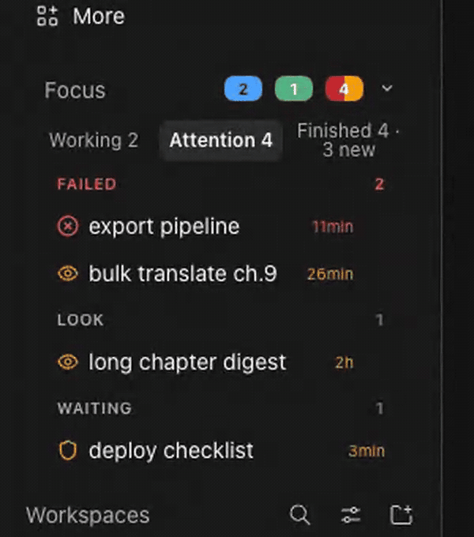

| 实际位置 | 需关注 | 进行中 | 已完成 |
|---|---|---|---|
| 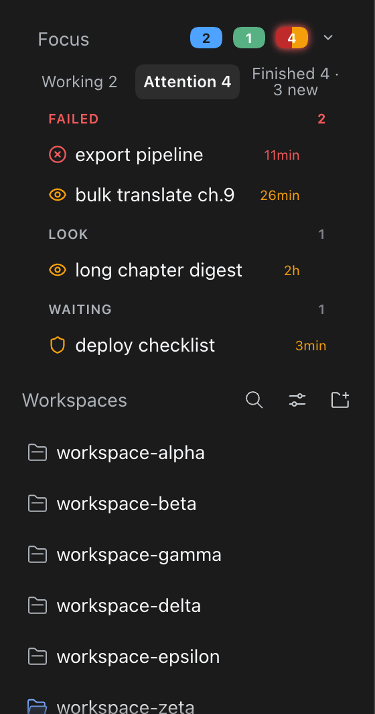 | 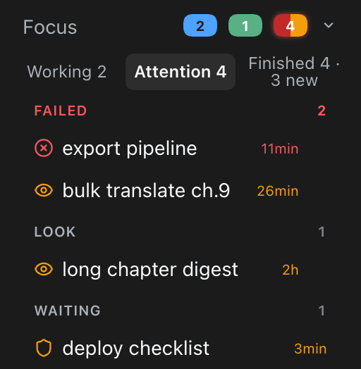 | 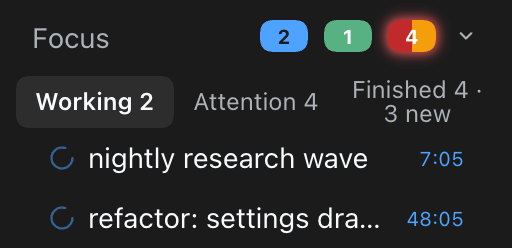 | 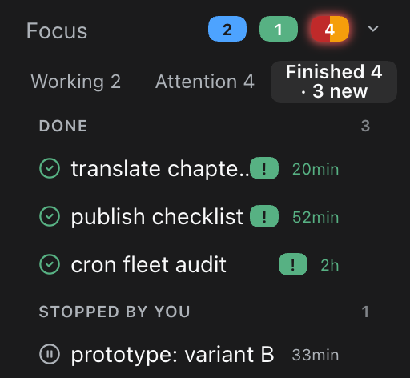 |

| 忽略与撤销 | 长列表 `+2 more` 截断 | 折叠态 |
|---|---|---|
|  | 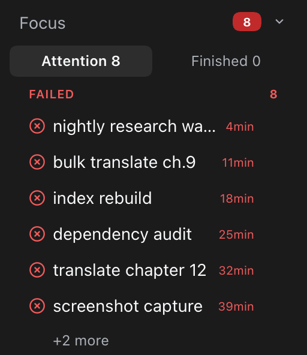 |  |
| 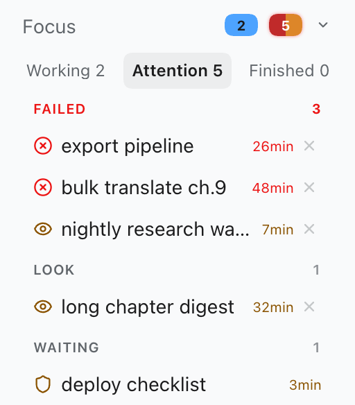 | | 同一块面板，浅色配色 |

## 想法

智能体框架很擅长*开工*，却不擅长*善后*。最后一个事件是 `error: 429 Too Many Requests` 的会话，在侧边栏里看起来和正在跑两小时重构的会话一模一样。等你点开才知道 —— 或者两天之后才知道。

心智模型是一块医院分诊板，而不是日志查看器：

```
┌────────────────────────────────────────────────────┐
│  Focus                        [2]  [1]  [4]      ⌄ │
│  Working 2    Attention 4    Finished 4 · 3 new    │
├────────────────────────────────────────────────────┤
│  FAILED                                        2   │
│    ⊗  export pipeline                     11min    │   红 = 致命回合错误
│    ◉  bulk translate ch.9                 26min    │   琥珀 = 429 / 配额 / 账单
│  LOOK                                          1   │
│    ◉  long chapter digest                   2h     │   琥珀 = 可疑状态，
│  WAITING                                        1  │          需要看一眼
│    ⛨  deploy checklist                    3min     │   琥珀 = 审批无人应答
└────────────────────────────────────────────────────┘
```

三条设计铁律：

1. **扫描绝不花你没花过的钱。** 客户端轮询插件自己的路由；路由*按请求*扫描会话日志（没有后台守护进程、没有 watcher），按文件 mtime 缓存，响应节流为每 20 秒最多一次扫描，10 秒后放弃并返回 `504 scan-timeout`。闲置的侧边栏零成本。
2. **标题永不泄漏秘密。** 每个行标题在离开服务端前都过一遍脱敏（`sk-…` 密钥、`Bearer …` 令牌、`token=…` 查询串形状一律剥除）。
3. **宿主毫发无损。** 区块是 *Workspaces* 区块上方的一次客户端 DOM 注入；服务端唯一入口是一条只读、带准入守卫的插件路由。卸载 = 侧边栏和从前一模一样。

## 升级

通过同一地址覆盖安装（插件 → 添加插件 → 粘贴 GitHub 地址，或 `dsh plugin --profile web add https://github.com/almazom/dsh-needs-attention-sidebar`）。插件原地重挂载；已保存状态（忽略列表、折叠状态、上次访问时间）全部保留。

## 安装

需要 DSH `>=0.2.0-rc.1`（安装时通过 `engines.dsh` 校验）。

直接从 GitHub 安装 —— 无需 npm。在 DSH 网页界面打开 **插件 → 添加插件**，粘贴仓库地址即可；或者命令行：

```bash
dsh plugin --profile web add github:almazom/dsh-needs-attention-sidebar
```

就这样。该命令把包装进 profile；因为包声明了 `dsh.bundle.patch`，DSH 会自动注册插件的 cordis 补丁。重启 Web 车道（或刷新页面），**Focus** 区块就出现在 *Workspaces* 上方。

包发布到 npm 之后，也可以用包名安装（效果相同）：

```bash
dsh plugin --profile web add @almazom/dsh-needs-attention-sidebar
```

无构建步骤、无生命周期脚本、纯 JavaScript —— 安装时什么都不执行。

### 分步安装图解

| | |
|---|---|
| **1.** 在侧边栏打开 **插件（Plugins）**。 | 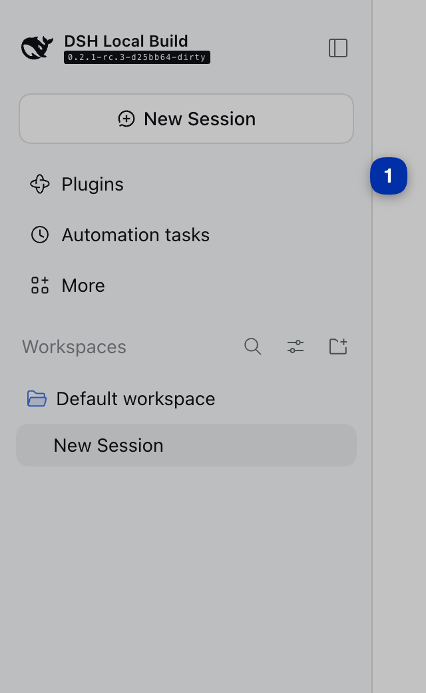 |
| **2.** 点击 **Add plugin（添加插件）**。 | 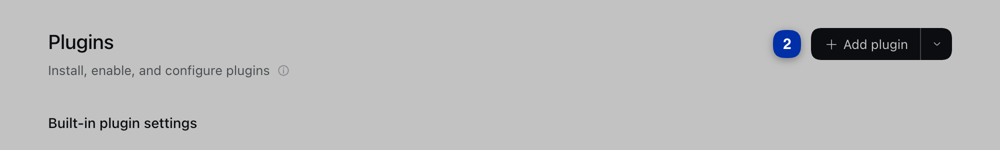 |
| **3.** 粘贴 `github:almazom/dsh-needs-attention-sidebar`，点击 **Install**。 | 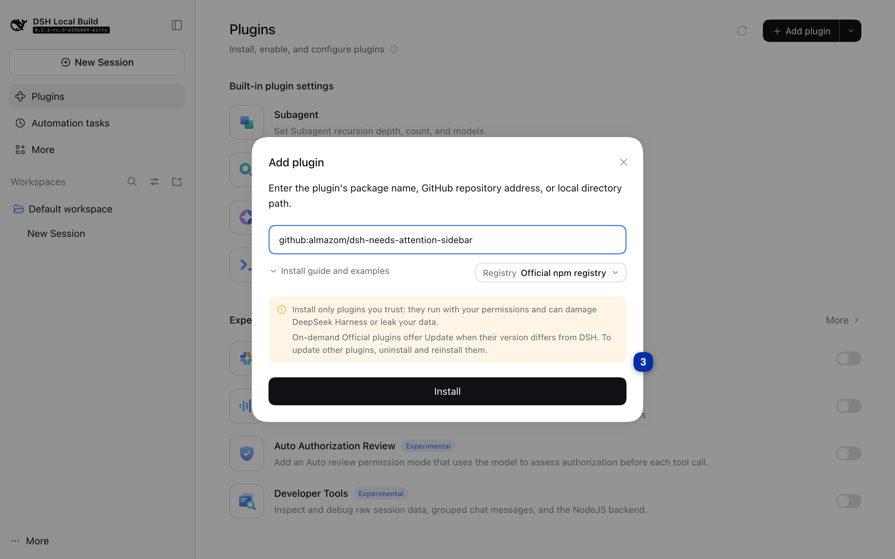 |
| **4.** 点击 **Enable now** 确认启用。 | 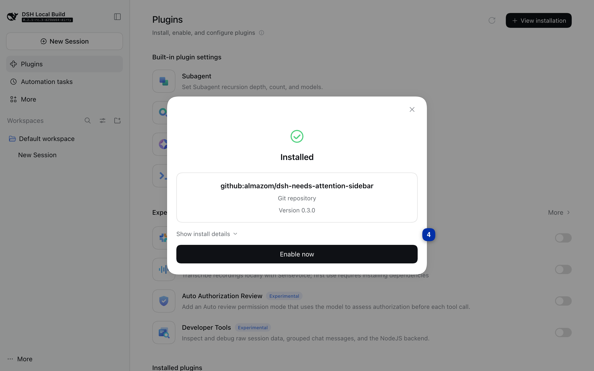 |
| **5.** 插件出现在 **Installed plugins** 列表中 —— 侧边栏里的 **Focus** 区块即刻生效。 | 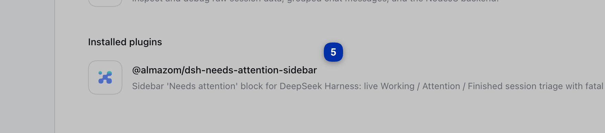 |

（以上五张截图来自在一台全新的 DSH `0.2.1-rc.3` 实例上的真实安装过程 —— 所见即所得。）

## 读懂区块

### 头部徽标

`[2] 蓝` 正在运行 · `[1] 绿` 被你停止的会话 · `[4] 琥珀` 需要关注。折叠箭头可把整个区块收成一行头部（状态持久化）。

### 标签页

- **Working N** —— 活跃会话。每行每秒跳动一次当前回合的时长。
- **Attention N** —— 只放警告，分组展示：
  - **FAILED**（红 ⊗）—— 会话最后一个终止事件是致命的回合错误/中止（5xx、认证、模型故障、413 载荷）。
  - **LOOK**（琥珀 ◉）—— 通常意味着输出降级或停滞的状态：`blocked`、`max-tokens` 截断、钩子中止，以及限流压力（429 / 配额 / 账单 / 5 小时上限等模式归入这类琥珀「limit」，而不是红）。
  - **WAITING**（琥珀 ⛨）—— 工具/审批请求一直无人应答。
- **Finished N · M new** —— 完成（绿 ✓）和你手动停止（灰 ⏸）的会话。完成后你没打开过的行带绿色 `!` 徽标（表示「新」，不是「警报」——警报由红/琥珀分组负责）；一条分隔线标出「自你上次访问以来」的一切。

### 行操作

- `×` 关掉某一行（跨刷新保留，带 **撤销** toast）。
- 每个标签、分组和行都有键盘焦点和 ARIA 标签；不用鼠标也能完成同样操作。
- 行多到放不下时，分组内部滚动并有 `+N more` 上限（每个列表最多 20 行 —— 扫描器拒绝在倒霉的一天把你的侧边栏炸掉）。

### 扫描器眼中的「近期」

只有新鲜窗口内被触碰过的会话才会被扫描（默认 **12 小时**，可配置）。更老的会话不再是你的问题 —— 这正是这个区块的意义。

## 隐私与安全

- **仅限本地。** 扫描读取你机器上的会话日志，只服务于你的浏览器会话。路由只应答已认证的 DSH Web 连接（精确路由准入守卫；回环兜底），非 `GET` 返回 `405`，且永不缓存（`Cache-Control: no-store`）。
- **无遥测、无外部请求。** 插件在任何地方发起的网络请求为零。
- **服务端脱敏。** 标题在序列化前脱敏 —— 密钥前缀、Bearer 头、token 查询参数永远不会到达 DOM。
- **只读。** 扫描器只读 harness 会话日志目录（`$DSH_HOME/sessions`，默认 `~/.dsh/sessions`）。什么都不写。

## 环境要求

- DSH `>=0.2.0-rc.1`
- Web 车道的 `PATH` 上要有 `zstd`（用 `zstdcat` 流式读取会话日志；macOS 上：`brew install zstd`）

## 配置

环境变量（为 DSH Web 车道进程设置，例如它的 launchd plist 或启动脚本）：

| 变量 | 默认 | 含义 |
|---|---|---|
| `DSH_NEEDS_ATTN_WINDOW_H` | `12` | 新鲜窗口（小时，1–720）。只有窗口内修改过的会话被扫描。 |
| `DSH_NEEDS_ATTN_DEADLINE_MS` | `10000` | 扫描截止。超过后路由返回 `504 {"error":"scan-timeout"}` 而不是阻塞。 |

## 底层原理

```
浏览器（client.js）                      DSH Web 车道（index.mjs → host.mjs → scanner.mjs）
──────────────                          ─────────────────────────────────────────────
锚点：侧边栏区块标题              轮询   GET /api/dsh-needs-attention/sessions
  [class*="_sectionLabel"]  ──────────▶  准入守卫（已认证连接或回环）
在 Workspaces 上方注入 <section>           否则 403
                              ◀──────   按请求：列出近期会话文件
标签 / 分组 / 跳动 / 未读                   （mtime 缓存，20 秒节流，单飞）
关闭 + 撤销 toast（localStorage）         zstdcat 每个文件，50 事件尾部环
折叠 / +N more / aria                    → 分类最后终止事件 + 活性
window.__DNA_STATUS__ 诊断               → 脱敏标题 → 行（≤20）、分组、计数
```

- **服务端**（`src/scanner.mjs`、`src/host.mjs`）：一条 GET 路由。只流式读取每个会话日志的尾部（50 事件环），6 文件并行，单文件 8 秒超时，扫描期间让出事件循环以免拖住车道，大日志用 8MB/60 秒复用缓存。按最后终止事件加活性（开放回合 + 近期文件 mtime）把每个会话分类为 `working / waiting / look / fatal / limit / ok / stopped`。
- **客户端**（`src/client.js`）：一个 ModuleLoader 工厂，只注入一次，锚定现有区块标题（跨语言生效 —— `Workspaces`/`工作区`/`Sessions`/`会话`），有行时 10 秒轮询、空时 30 秒，配合旧版服务端优雅降级（退化为只显示错误的条）。
- **接线**（`index.mjs`、`cordis.patch.yml`）：插件注入 `webServer` + `connection` 并注册 cordis insert。这一切都从 `package.json` 被发现 —— 核心永远不知道这个插件的存在。

## 兼容性

| DSH | 状态 |
|---|---|
| `>=0.2.0-rc.1` | 支持（通过顶层 `engines.dsh` 强制校验） |

客户端带 strip-states 守卫：配合旧版服务端构建时退化为只显示错误的列表，而不是崩掉。

## 开发

```bash
npm install        # 仅开发需要：无需构建，纯 JS
npm test           # 44 个测试（node:test）—— 扫描器、路由、客户端、接线
```

```
index.mjs            宿主入口（name / inject / apply）
src/host.mjs         路由 + 准入守卫 + 截止
src/scanner.mjs      会话扫描、分类、脱敏
src/client.js        侧边栏注入 + UI（原生 JS，零依赖）
cordis.patch.yml     cordis insert 声明
tests/               node:test 套件
screenshots/         本 README 使用的截图
```

运行时 npm 依赖：**无**。客户端是零依赖原生 JS；服务端只用 Node 内置模块加系统 `zstd` 二进制（见「环境要求」）。

## 许可证

[MIT](LICENSE)
